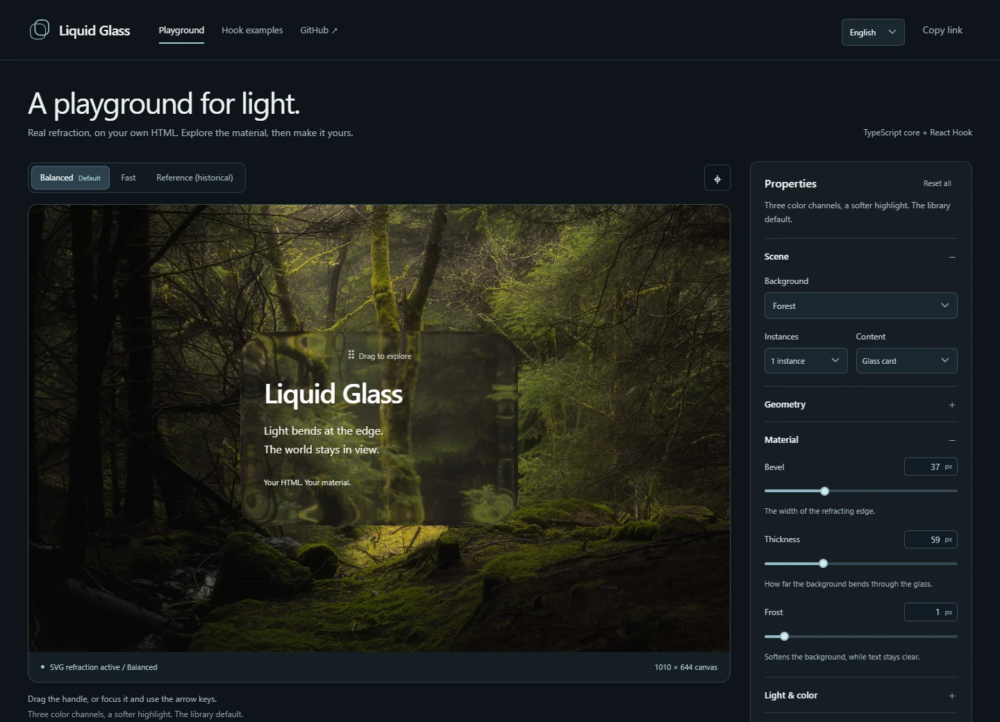

# Liquid Glass

[English](README.md) · [简体中文](README.zh-CN.md) · [CI](https://github.com/librecosta/liquid-glass/actions/workflows/ci.yml)

A headless liquid-glass renderer with a native TypeScript core and one React Hook. Bind real refraction to your own HTML. Keep complete control of your CSS, layout and native interactions.



## Features

- Framework-independent ESM core; React 19 integration through `useLiquidGlass`.
- Independent instances, shared map/filter caches, resize handling and explicit cleanup.
- Balanced by default; switch to Fast on the same instance when performance matters.
- Your divs, buttons and inputs. No prescribed component designs or UI framework.
- A responsive Playground with forest/grid/local-image backgrounds, real dragging and English/简体中文 controls.

## Installation

**The package is not published to npm yet.** Build a local tarball from `dev` using Node 24+:

```sh
git clone https://github.com/librecosta/liquid-glass.git
cd liquid-glass
git switch dev
npm ci
npm pack
```

This creates `librecosta-liquid-glass-0.0.0.tgz`. In an existing app located next to the repository, install the real file:

```sh
# Run from your app directory, alongside liquid-glass/
npm install ../liquid-glass/librecosta-liquid-glass-0.0.0.tgz
```

For another directory layout, use the tarball's absolute path. React/React DOM 19 are peers; the core entry itself does not import React. The independent consumer check tests this tarball installation outside the repository, without aliases or symlinks.

After a future public npm release, installation will be `npm install @librecosta/liquid-glass`. That registry command is not available yet; the package currently remains private.

## Quick Start

### TypeScript / JavaScript

Create the element and its appearance yourself. Place it over a detailed background to see refraction:

```html
<div class="my-glass liquid-glass">Your content</div>
<style>
  .my-glass {
    width: 300px;
    min-height: 180px;
    padding: 24px;
    border-radius: 32px;
  }
</style>
```

```ts
import { createLiquidGlass, QUALITY_PRESETS } from "@librecosta/liquid-glass";
import "@librecosta/liquid-glass/styles.css"; // optional effect rules

const glass = createLiquidGlass(
  document.querySelector<HTMLElement>(".my-glass")!,
);
// No options = Balanced.
glass.setOptions(QUALITY_PRESETS.Fast);
glass.setOptions({ ...QUALITY_PRESETS.Balanced, rim: 0.5 });
glass.refresh(); // after external stylesheet/ancestor geometry changes
// glass.destroy(); // when the element is no longer needed; safe to repeat
```

### React Hook

```tsx
import { useLiquidGlass } from "@librecosta/liquid-glass/react";
import { QUALITY_PRESETS } from "@librecosta/liquid-glass";
import "@librecosta/liquid-glass/styles.css";

function MyButton({ fast = false, disabled = false }) {
  const { ref } = useLiquidGlass<HTMLButtonElement>({
    options: fast ? QUALITY_PRESETS.Fast : undefined,
  });
  return (
    <button
      ref={ref}
      className="liquid-glass my-button"
      type="button"
      disabled={disabled}
    >
      Save
    </button>
  );
}
```

Define `.my-button` with your own spacing, radius, colors and focus state. `useLiquidGlass()` without configuration uses Balanced. The Hook returns `ref` and `refresh`; `enabled` controls the effect independently of native `disabled`. A state/prop change updates the existing binding without remounting.

For inputs, bind the glass to a decorative `pointer-events:none` background layer and place a transparent native input above it. Text, caret, selection and forms remain native. See the runnable [Hook examples](src/components-demo.tsx) for controlled email input, independent instances and native buttons.

## Configuration

Presets are parameter combinations for the same renderer:

| Configuration                     | dispersion |  sat | edge |  rim |
| --------------------------------- | ---------: | ---: | ---: | ---: |
| Balanced — default                |        0.8 |    1 |    0 | 0.80 |
| Fast — performance choice         |          0 |    1 |    0 | 0.80 |
| Reference — historical regression |        1.6 | 0.86 | 0.32 | 1.76 |

Fast removes chromatic separation. Reference restores the complete original configuration; it is not the recommended default. Optical Balanced remains an explicitly labeled historical experiment in the Playground.

Any optical field can be overridden, including bevel, thickness, blur, shade and light direction. Core `setOptions` merges a local patch; Hook `options` are a complete value, so omitted fields return to defaults. Balanced/Fast explicitly set all four quality fields. Materialize plays on binding, not updates. Radius changes on the bound DOM are observed; use `refresh()` for external stylesheet/ancestor changes.

Optional CSS only consumes `--hyalite` and `--hyalite-edge`; it sets no button/input layout, radius, font, padding or border. Without it, use those variables in your own `backdrop-filter` and `box-shadow` rules. Self mode instead uses `filter` (the optional stylesheet provides `[data-liquid-glass-self]` rules). The public API is core + one Hook, with no prefab components or global manager.

## Browser Support

Chromium provides SVG backdrop refraction. Other engines receive CSS blur fallback; real Safari/Firefox, password managers and assistive-technology combinations still need broader testing. Five or more overlapping surfaces can be expensive; use Fast and measure on your target device. rAF callbacks are not a painted-FPS guarantee.

Strict CSP must permit map images with `img-src data:`; the Playground also needs its local image asset and `blob:` uploads. CSP denial is not automatically detected. Existing folded-field, percentage/elliptical-radius and overlapping-filter limitations remain. Imports and Hook server rendering are SSR-safe; DOM binding is client-only.

## Development

```sh
npm ci
npm run dev       # http://127.0.0.1:5173
npm run check     # Node, types/builds, browser checks, independent tarball app
npm run build     # dist/ library + dist-playground/ website
```

Use `/` for the Playground and `/components.html` for Hook examples. English is the default; language persists locally and can be shared with `?lang=en` or `?lang=zh-CN`. Quality links accept `?quality=Fast` or `?quality=Reference`. Images never leave the browser.

Local checks use installed Chrome (`LG_CHROME` can select an executable). CI uses the Chromium revision pinned by Playwright: `npx playwright install --with-deps chromium`, then set `LG_BROWSER=chromium`. Ubuntu runs all behavior, SSR and consumer checks, original exact Node math, and decoded map/SVG contracts. Windows Chrome pixel goldens stay unchanged and run on their compatible capture environment; Ubuntu explicitly skips those two platform-specific screenshot tests. `LG_EXACT_PIXELS=1` opts into the exact screenshots; `0` skips them. Stable `?fixture=1` remains a separate 500×480 regression scene, independent of the responsive website and UI language.

CI validates pushes to `dev`/`main` and pull requests. It does not publish, deploy, tag or create Releases. See [validation notes](docs/lg-d-validation.md) for the current acceptance results; earlier experiments remain in `docs/` as historical records.

## License

MIT. The adapted renderer retains the complete [Hyalite MIT notice](licenses/Hyalite-MIT.txt). The demo-only forest image and other provenance are documented in [third-party notices](THIRD_PARTY_NOTICES.md). An independent [LibreCosta](https://github.com/librecosta) project.
