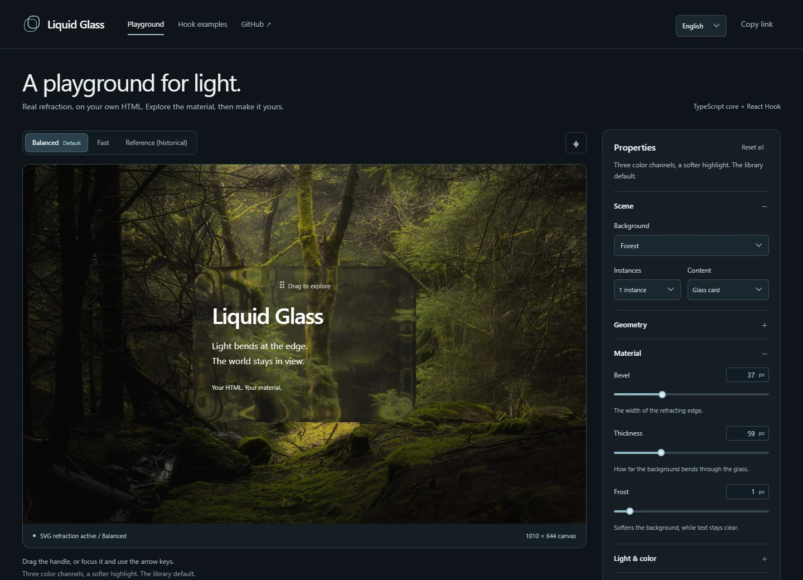

# Liquid Glass

[English](README.md) · [简体中文](README.zh-CN.md) · [CI](https://github.com/librecosta/liquid-glass/actions/workflows/ci.yml)

Headless 液态玻璃渲染库，提供原生 TypeScript 核心和唯一 React Hook。把真实折射绑定到自己的 HTML，完整掌控 CSS、布局和原生交互。

**v0.1.0** · [npm](https://www.npmjs.com/package/@librecosta/liquid-glass) · [发行说明](https://github.com/librecosta/liquid-glass/releases/tag/v0.1.0)



## 特性

- 框架无关的 ESM 核心，通过 `useLiquidGlass` 接入 React 19。
- 独立实例、共享贴图和滤镜缓存、尺寸变化处理与显式清理。
- 默认 Balanced；需要优先保证性能时，在同一实例上动态切换 Fast。
- 自己创建 div、button、input，不依赖预制组件或 UI 框架。
- 响应式 Playground，支持森林、精确网格、本地图片、真实拖动与中英双语。

## 安装

```sh
npm install @librecosta/liquid-glass@0.1.0
```

核心没有运行时依赖，安装时不会引入 React。React `^19.0.0` 是仅供 `/react` 使用的可选 peer，React DOM 应用自行提供 React DOM。验证使用没有源码别名或软链接的独立工程，分别检查不含 React 的核心工程和 React/React DOM 19.2.0 工程。

## 快速开始

### TypeScript / JavaScript

自己创建元素并定义外观，放在细节丰富的背景上观察折射：

```html
<div class="my-glass liquid-glass">你的内容</div>
<style>
  .my-glass {
    width: 300px;
    min-height: 180px;
    padding: 24px;
    border-radius: 32px;
  }
</style>
```

```ts
import { createLiquidGlass, QUALITY_PRESETS } from "@librecosta/liquid-glass";
import "@librecosta/liquid-glass/styles.css"; // 可选的特效规则

const glass = createLiquidGlass(
  document.querySelector<HTMLElement>(".my-glass")!,
);
// 不传参数就是 Balanced。
glass.setOptions(QUALITY_PRESETS.Fast);
glass.setOptions({ ...QUALITY_PRESETS.Balanced, rim: 0.5 });
glass.refresh(); // 外部样式表或祖先元素改变几何后主动刷新
// glass.destroy(); // 元素不再使用时清理，可重复调用
```

### React Hook

```tsx
import { useLiquidGlass } from "@librecosta/liquid-glass/react";
import { QUALITY_PRESETS } from "@librecosta/liquid-glass";
import "@librecosta/liquid-glass/styles.css";

export function MyButton({ fast = false, disabled = false }) {
  const { ref } = useLiquidGlass<HTMLButtonElement>({
    options: fast ? QUALITY_PRESETS.Fast : undefined,
  });
  return (
    <button
      ref={ref}
      className="liquid-glass my-button"
      type="button"
      disabled={disabled}
    >
      保存
    </button>
  );
}
```

通过自己的 `.my-button` 定义间距、圆角、颜色与焦点状态。无配置的 `useLiquidGlass()` 使用 Balanced。Hook 返回 `ref` 和 `refresh`；`enabled` 独立控制特效，与原生 `disabled` 无关。状态或属性变化会更新当前绑定，无需重新挂载。

输入框应将玻璃绑定到 `pointer-events:none` 的装饰背景层，再把透明原生输入框放在上方，保持文字、光标、选择与表单行为原生。可运行的 [Hook 示例](https://github.com/librecosta/liquid-glass/blob/main/src/components-demo.tsx) 展示了受控邮箱输入、独立实例与原生按钮。

## 可选材质 — 尚未发布的 v0.1.1 候选

`dev` 分支新增 `@librecosta/liquid-glass/materials.css`。**已发布的 v0.1.0 不包含此入口。** 请按[开发](#开发)说明安装本地 tarball 体验；候选包版本暂留 0.1.0，等待正式发行批准。

先导入 `styles.css` 提供基础折射规则，再导入 `materials.css` 选择纯 CSS 皮肤。`QUALITY_PRESETS` 独立控制光学画质，选择 Prismatic 不会改变 Quality。Clear 保留 v0.1.0 Playground 着色；Soft 使用 7% 着色，显式浅色主题为 6%；Prismatic 使用中性渐变和高光。

```html
<div class="liquid-glass material-demo" data-lg-material="clear">自己的 div</div>
<button class="liquid-glass material-demo" type="button"
  data-lg-material="soft" data-lg-theme="light" data-lg-decorate>保存</button>
<label>邮箱
  <span class="field-stack">
    <span class="liquid-glass field-surface" aria-hidden="true"
      data-lg-material="prismatic" data-lg-theme="light" data-lg-decorate></span>
    <input class="field-input" name="email" type="email" autocomplete="email">
  </span>
</label>
```

```css
/* 应用自己的 CSS：几何、定位、文字对比度及原生控件状态。 */
.material-demo { position: relative; width: 280px; padding: 24px; border: 0; border-radius: 28px; font: inherit; color: inherit; }
.field-stack { position: relative; display: inline-grid; border-radius: 12px; }
.field-surface { position: absolute; inset: 0; border-radius: inherit; pointer-events: none; }
.field-input { position: relative; min-width: 0; padding: 12px; border: 0; border-radius: inherit; background: transparent; font: inherit; color: inherit; }
.material-demo:focus-visible, .field-input:focus-visible { outline: 2px solid currentColor; outline-offset: 3px; }
.material-demo:disabled { opacity: .5; }
```

```ts
import { createLiquidGlass } from "@librecosta/liquid-glass";
import "@librecosta/liquid-glass/styles.css";
import "@librecosta/liquid-glass/materials.css";

const surfaces = Array.from(document.querySelectorAll<HTMLElement>(".material-demo, .field-surface"));
const bindings = surfaces.map(element => createLiquidGlass(element));
// 移除元素时：bindings.forEach(binding => binding.destroy());
```

自己的 React 元素可在现有 Hook `ref` 旁使用相同属性，无需材质 JS API。必须同时提供 `.liquid-glass` 和 `data-lg-material="clear|soft|prismatic"`。在**每个装饰宿主**设置 `data-lg-theme="light|dark"`；缺省或未知主题采用深色着色，不推断祖先或系统主题。文字对比度、布局、圆角、焦点、禁用状态、裁切与层级均由应用控制。

`data-lg-decorate` 显式为 Soft/Prismatic 高光和阴影保留一个**尚未使用的 `::after`**。宿主已有该伪元素时请省略它，仅应用底色/渐变。宿主自行提供定位上下文；材质不会改变 absolute/fixed/static 定位。原生 input 使用上面的独立 `aria-hidden` 装饰层。宿主规则只有一个属性选择器的特异性，后加载的应用 class 可覆盖。完整说明见[候选契约与验收](docs/v0.1.1-material-contract.md)。

## 配置

画质是同一个渲染器的参数组合：

| 配置                 | dispersion |  sat | edge |  rim |
| -------------------- | ---------: | ---: | ---: | ---: |
| Balanced — 默认      |        0.8 |    1 |    0 | 0.80 |
| Fast — 性能优先      |          0 |    1 |    0 | 0.80 |
| Reference — 历史回归 |        1.6 | 0.86 | 0.32 | 1.76 |

Fast 不保留彩色边缘分离。Reference 恢复完整原始配置，仅用于历史比较，不是推荐默认值。Optical Balanced 在 Playground 中保留为明确标注的历史实验对照。

所有光学字段均可覆盖，包括斜面、厚度、磨砂、暗部与光线方向。核心 `setOptions` 合并局部 patch；Hook 的 `options` 是完整值，省略的字段回到默认配置。Balanced/Fast 均显式提供四项画质参数。入场材质化只在绑定时播放，更新不会重播。绑定元素上的圆角变化会被观察；外部样式表或祖先元素变化后可调用 `refresh()`。

现有 `styles.css` 只消费 `--hyalite`、`--hyalite-edge`，不会规定按钮或输入框的布局、圆角、字体、内边距和边框。不导入它时，可在自己的 `backdrop-filter` 与 `box-shadow` 中消费这些变量。Self 模式改用 `filter`，基础样式提供了 `[data-liquid-glass-self]` 规则。独立的候选 `materials.css` 只负责可选背景和装饰。公开 API 保持核心加唯一 Hook，没有预制组件和全局管理器。

## 浏览器支持

Chromium 提供 SVG 背景折射，其他引擎使用 CSS 模糊回退。实际 Safari/Firefox、密码管理器与辅助技术组合仍需更多验证。五张及以上玻璃重叠时成本可能明显增加，请使用 Fast 并在目标设备测量；rAF 回调并不等于真实绘制帧率。

严格 CSP 需要通过 `img-src data:` 允许贴图，Playground 还需要本地背景资源和 `blob:` 图片。暂不能自动检测 CSP 拒绝。折叠场、百分比／椭圆圆角及重叠滤镜的既有限制仍存在。导入与 Hook 服务端渲染保持 SSR 安全，DOM 绑定仅在客户端进行。

发行 ESM 以 ES2022 为目标。Node 24+ 是本仓库开发/构建工具的要求，不是浏览器消费者的运行时门槛。SSR 在 Node 24 与 React 19.2.0 上验证，不承诺未经验证的最低 Node 运行时版本。

## 开发

```sh
npm ci
npm run dev       # http://127.0.0.1:5173
npm run dev:stop  # Windows：仅停止已确认属于本仓库的 dev/preview；加 -- --port 5174 指定端口
npm run check     # Node、类型/构建、浏览器、tarball 与生产根路径/子路径
npm run build     # dist/ 库产物 + dist-playground/ 展示网站
```

本地包验证可在 `npm ci` 后执行 `npm pack`，再通过文件路径将 `librecosta-liquid-glass-0.1.0.tgz` 安装到另一应用。发布后，可从检出的正式发行提交执行 `npm run test:consumer -- --registry`，对官方 Registry 的精确版本验证完整性、核心、Hook、类型与许可证。

`/` 为交互舞台，`/components.html` 为 Hook 示例。默认英文，语言保存在本地，可通过 `?lang=en` 或 `?lang=zh-CN` 分享。画质入口支持 `?quality=Fast`、`?quality=Reference`。本地图片不会离开浏览器。

在 GitHub Pages 项目子路径下进行本地生产预览：

```sh
npm run build:pages
npm run preview:pages -- --port 4175
# http://127.0.0.1:4175/liquid-glass/?lang=en&quality=Fast
# http://127.0.0.1:4175/liquid-glass/components.html?lang=zh-CN
```

该命令生成 `dist-pages/`，用于本地审核，没有启用公开托管。正式托管前需确认照片的原始权利来源或替换素材。[发行清单](docs/v0.1.0-release-checklist.md) 记录了验证流程及剩余的照片/托管限制。

本地验证使用已安装的 Chrome，可用 `LG_CHROME` 指定可执行文件。CI 使用 Playwright 固定版本的 Chromium：先执行 `npx playwright install --with-deps chromium`，再设置 `LG_BROWSER=chromium`。Ubuntu 验证全部行为、SSR、consumer、原有精确 Node 数学断言与解码后的精确贴图／SVG 契约；原有 Windows Chrome 像素金样保持不变，在兼容的采集环境执行，Ubuntu 明确跳过这两项平台专属截图测试。`LG_EXACT_PIXELS=1` 强制像素验证，`0` 跳过。稳定的 `?fixture=1` 仍是独立的 500×480 回归场景，不受响应式布局和界面语言影响。

CI 覆盖 `dev`/`main` 推送与 pull request，包括 `/` 与 `/liquid-glass/` 下的两个生产入口。只做验证，不发布、部署、打标签或创建 Release。发行验证见 [发行清单](docs/v0.1.0-release-checklist.md)，网站基线见 [LG-D 记录](docs/lg-d-validation.md)，早期实验保留为历史资料。

## 许可

代码采用 MIT。改编渲染器保留完整 [Hyalite MIT 许可](licenses/Hyalite-MIT.txt)。森林照片只有所有者提供的 CC0 说明，原始来源证据尚未独立核实，不能用源仓库 MIT 证明照片权利。照片和衍生预览图均不进入 npm tarball，详见 [第三方通知](THIRD_PARTY_NOTICES.md)。本项目由 [LibreCosta](https://github.com/librecosta) 独立开发。
