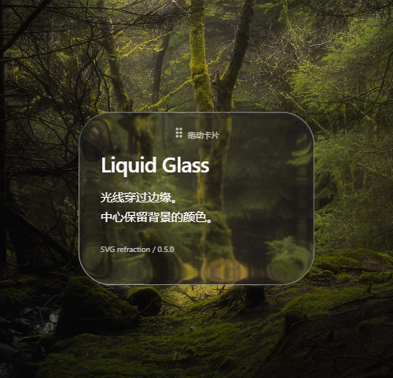
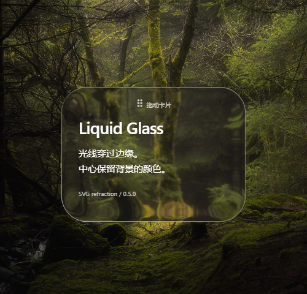
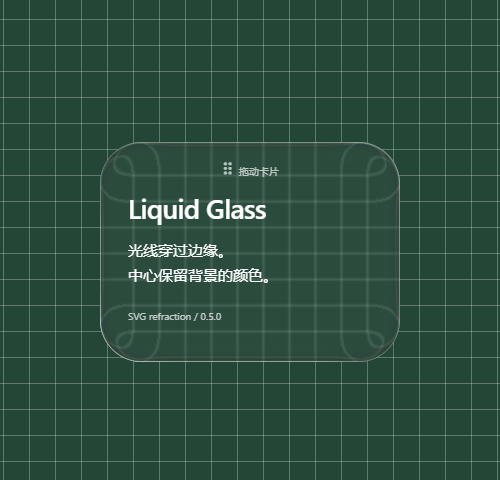
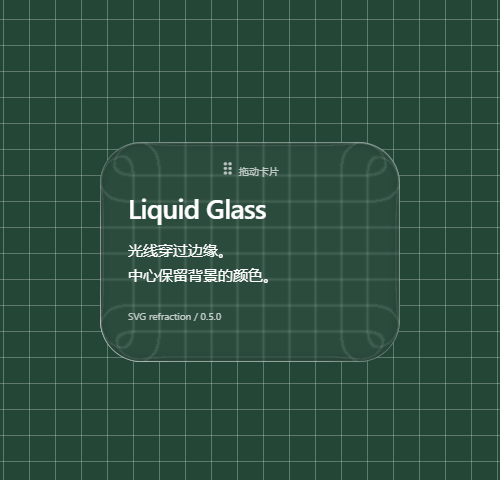

# LG-C — 单引擎、拖动性能与画质实验

历史记录：本页数字/三档截图采自 `d3cbe91`，当时库默认为 Reference，Balanced/Fast 沿用 edge=0.32、rim=1.76。下文“默认/当前”均指当时状态。当前 Balanced 默认及 Fast 配置见 [LG-C3](lg-c3-defaults.md)；Headless 收敛记录见 [LG-C2](lg-c2-finalization.md)。复现本页测量须使用 `d3cbe91` 的脚本及源码。

[当前 Playground 截图](lg-c-playground.png)。实施范围为 [Issue #3](https://github.com/librecosta/liquid-glass/issues/3)。基线 `b257c17`，仅在 `dev` 交付。默认 Reference 的光学数学、参数、贴图、编码、量化、缓存和 resize 调度均未修改。删除了上游运行源码/演示/旧 runner 与双 iframe；完整改编代码 MIT 许可保留在 `licenses/Hyalite-MIT.txt`，也进入本地 tarball。

## 环境与方法

2026-11-05，Windows x64 / Ryzen 7 5800H / Node 24.22.1 / npm 9.6.7 / Chrome 156.0.8078.76，主显示器 1920×1080 / 240Hz；headless，viewport 1480×960，固定 500×480 场景。开发版与生产版、DPR 1/2，每项三轮；每次只运行一个画质。旧页仍为双引擎，新页为单引擎，这是整页改版比较，不能称为核心算法提速。旧 checkout 只换同一森林/16% 遮罩并隐藏背景大字，没有改变核心或拖动实现。

冷载指新 context、关闭 HTTP 缓存的导航至 ready 且图片 decode 完成；服务端与 Chrome 进程可能已热。热载为同 context 下一次启用 HTTP 缓存的导航。另用每轮全新 Chrome 进程采集首次图像解码 trace。单卡为 90 次实际 `mouse.move`，5/20 张重叠卡各 45 次，事件间请求等待 8ms，但 CDP/绘制会增加实际总时长；通过 pointer capture 验证确实拖动。实例数指 TS 场景，旧页另有一张同步移动的原版卡。resize 连续 30 个真实 rAF 改宽度 314→401px。表中为三轮统计值的中位数，逐轮数据与范围可在 [测量 JSON](lg-c-measurements.json) 检查。

rAF p50/p95/p99 是帧回调间隔，不是 GPU 帧时间。静置 10 秒也挂着采样 rAF，该探针本身会持续请求帧，不能将其约 240Hz 的空闲通知当作页面常驻动画或能耗。地图数来自 `buildMap` 每次创建的一个 2D canvas，与 onBuild 交叉核对；PNG 编码单独计时。React 只记录可靠的 commit hook，不声称 render 数。CDP ScriptDuration 包含探针/自动化调用，不等于纯应用 CPU。通过 CDP 读取的实际后端为 AMD Radeon Graphics / ANGLE D3D11（驱动 31.0.21921.1000），GPU compositing/rasterization enabled，仅表示功能启用。每条件第一轮保留 Paint/合成 trace；事件可能跨线程、互相包含，时长不相加作为墙钟时间。未测 GPU 使用率或功耗，风扇声音不计入数据。

## 根因与改动

旧页每个 pointermove 经 `postMessage` 往返，触发父级与两帧的 React 提交；纯平移没有重建地图。新页直接使用同一 TS 核心实例；移动期间在一帧内合并事件，只改未绑定玻璃的定位 wrapper 的 transform，绕开半径 MutationObserver 的布局读取；释放/cancel 后一次同步 React。保留 capture/lost capture/cancel、边界、方向键及卸载清理。没有加入永久 will-change、Worker、新后端或地图优化。

### Reference 前后结果（单卡）

| 环境 / DPR | p50 ms 前→后 | p95 ms 前→后 | p99 ms 前→后 | >33 / >50ms 次数 前→后 | Script ms 前→后 |
| --- | ---: | ---: | ---: | ---: | ---: |
| 开发 / 1 | 33.3 → 12.5 | 45.7 → 16.7 | 66.7 → 20.8 | 85/4 → 0/0 | 842.5 → 24.5 |
| 开发 / 2 | 33.2 → 8.3 | 45.8 → 20.9 | 54.1 → 20.9 | 66/3 → 0/0 | 795.9 → 24.7 |
| 生产 / 1 | 29.2 → 12.5 | 33.4 → 16.7 | 37.5 → 16.8 | 41/0 → 0/0 | 139.0 → 16.9 |
| 生产 / 2 | 29.1 → 12.5 | 33.3 → 16.7 | 33.4 → 20.8 | 20/0 → 0/0 | 121.9 → 16.4 |

90 次移动的 React 提交各轮均为 **360 → 1**，消息接收 **270 → 0**；前后拖动的地图/PNG/RO 均为 0。生产 DPR 1 总拖动时长中位数 3228.5 → 1515.2ms；这包含事件发送与等待，不是光学算法耗时。

| 环境 / DPR | 冷载 ms 前→后 | 热载 ms 前→后 | resize p95 ms 前→后 | resize 地图数 前→后 |
| --- | ---: | ---: | ---: | ---: |
| 开发 / 1 | 435 → 269 | 211 → 128 | 49.9 → 25.0 | 12 → 7 |
| 开发 / 2 | 416 → 275 | 218 → 182 | 45.9 → 25.0 | 12 → 7 |
| 生产 / 1 | 306 → 217 | 153 → 99 | 41.7 → 20.9 | 11 → 7 |
| 生产 / 2 | 297 → 215 | 146 → 97 | 41.7 → 24.9 | 10 → 7 |

启动各轮从两套地图构建变为一套。resize 的 RO 回调中位数仍为 29；完成 30 个 rAF 的实际时间缩短，既有 90ms 重建节流因此触发更少次，不能据此声称缓存或地图算法优化。

48 组静置 10 秒均为地图/PNG/commit/RO 0，第一轮静置 trace 也均为 Paint/RasterTask 0。生产 DPR 1 的拖动 trace：Paint 2 → 0；`PaintArtifactCompositor::Update` 96 次/9.985ms → 88 次/6.923ms。主线程脚本减少后，多层 SVG 仍有明显瓶颈；这些事件不是完整 GPU 执行时间。

### 启动中的图片、地图与编码

| 环境 / DPR | JPEG Decode Image 合计 ms | 所有图像 decodeAndScale 合计 ms | 新地图至 onBuild ms | 其中 PNG 编码 ms | 总 attach ms |
| --- | ---: | ---: | ---: | ---: | ---: |
| 开发 / 1 | 42.2 | 56.7 | 11.4 | 3.4 | 12.0 |
| 开发 / 2 | 44.7 | 60.7 | 11.7 | 3.2 | 12.4 |
| 生产 / 1 | 46.3 | 65.3 | 11.4 | 3.8 | 12.2 |
| 生产 / 2 | 47.7 | 65.1 | 11.3 | 3.8 | 13.8 |

JPEG 是唯一森林照片；decodeAndScale 还含贴图 PNG，并包含 JPEG 解码，不能与前列相加或当作纯缩放耗时。地图 probe 为新 317×219、17px 圆角（实际桶 319×223），代码此前已执行默认地图；onBuild 上界含解析、SDF 与 PNG，不能把剩余时间当纯 SDF。整页启动 RasterTask 合计中位数为 2.35–2.64ms，另有图像上传/合成；无法可靠单独分离 CSS cover 的 GPU 缩放。地图约 11–12ms 的一次性工作不是拖动时重复重建。

## 画质与图像

森林资产为指定源仓库提交的原始 JPEG：3840×2160、3,245,572 字节，SHA-256 `164dee65d752ca0a975b3f0fc6ca35727b5d9fce2788f9e86e304fc58b9f6813`。本地导入、center/cover、16% 克制遮罩；未降采样/压缩。仅原图解码为 RGBA 的理论大小约 31.6 MiB，这不是实际 GPU 内存测量。库 tarball 不含照片，也不依赖它。另保留 26px 精准直线网格及本地上传。

照片许可采用仓库所有者 2026-11-05 提供的 CC0 信息；未获得原始素材页/摄影者，不能独立核实。源仓库 MIT 不作为照片权利证明，见 [许可与来源](../THIRD_PARTY_NOTICES.md) 和 [资源记录](../src/assets/forest.provenance.json)。

| 档位 | dispersion / sat | 顶层 SVG primitive / 位移节点 | 明确损失 |
| --- | --- | --- | --- |
| Reference（默认） | 1.6 / 0.86 | 28 / 3 | 保持全部已验收效果 |
| Balanced（实验） | 0.8 / 1 | 18 / 3 | 色边减弱、取消边缘去饱和校正 |
| Fast（实验） | 0 / 1 | 11 / 1 | 取消色彩通道分离及边缘去饱和校正，仍有真实折射 |

三档默认地图尺寸均为 306×223，未改分辨率或量化。一次一个档位的 p95 ms（单卡 / 5 张 / 20 张）：

| 环境 / DPR | Reference | Balanced | Fast |
| --- | ---: | ---: | ---: |
| 开发 / 1 | 16.7 / 91.6 / 366.7 | 4.3 / 33.4 / 129.2 | 4.3 / 16.7 / 66.7 |
| 开发 / 2 | 20.9 / 91.8 / 391.7 | 4.3 / 33.3 / 133.3 | 4.3 / 16.7 / 66.6 |
| 生产 / 1 | 16.7 / 83.4 / 358.4 | 4.3 / 33.3 / 129.2 | 4.3 / 16.7 / 66.7 |
| 生产 / 2 | 16.7 / 87.5 / 354.2 | 4.3 / 33.4 / 133.4 | 4.3 / 16.7 / 66.7 |

**20 张重叠玻璃仍慢**：生产 Reference p95 354–358ms，Fast 也约 67ms，不能承诺多层场景流畅。静置帧通知与快速档位约 4.3ms 的 rAF p95 均受本机 240Hz 时钟/事件间空闲影响，不等于实际画面以 240fps 绘制。

逐项实验：生产版、45 次真实移动，每项/DPR 三轮；表内为中位数。

| 只改变的参数 | primitive / 位移节点 | p95 ms DPR1 / DPR2 | Script ms DPR1 / DPR2 |
| --- | --- | ---: | ---: |
| 无（Reference） | 28 / 3 | 16.7 / 16.7 | 11.2 / 10.4 |
| dispersion=0.8 | 28 / 3 | 20.8 / 16.7 | 11.8 / 10.7 |
| sat=1 | 18 / 3 | 4.3 / 4.3 | 12.1 / 11.3 |
| 0.8 + sat=1（Balanced） | 18 / 3 | 4.3 / 4.3 | 11.2 / 12.7 |
| 0 + sat=1（Fast） | 11 / 1 | 4.3 / 4.3 | 10.9 / 11.7 |

仅降低色散没有减少节点，也未测到可靠加速；本机收益主要来自 sat=1 走既有的跳过校正分支，以及 Fast 单通道。JS 时间基本相近、地图未重建；据此把剩余拖动瓶颈归于滤镜/合成路径，而不改 SDF/编码。primitive 按 `filter.children.length` 计数。

生产 Reference 的森林/网格截图也与冻结金样 **0 像素差异**。Balanced/Fast 相对 Reference 的森林差异为 15,363 / 16,124 像素，网格为 17,357 / 17,411；玻璃范围外的背景均为 0 差异。差异数是零容差检测结果，不是主观质量评分。

同一位置、尺寸、背景及 Chrome/DPR 1；以下只是截图，性能始终单档运行。比较截图为三档分别启动独立 Chrome，并在首次渲染前选好参数，确保玻璃范围外的背景像素一致。冻结金样则独立启动 Chrome，保持历史采集的首次 JPEG 路径：同一进程重复加载可能改变 JPEG 重采样结果（调查中最大单通道差 9、平均绝对差约 0.239），不能用它混淆光学差异；金样文件和零容差均未修改。

| 背景 | Reference | Balanced（实验） | Fast（实验） |
| --- | --- | --- | --- |
| 森林 |  |  |  |
| 网格 |  |  |  |

## 回归、复现与限制

`npm run check`：Node 冻结数学/defaults/SSR、严格 TS 与双输出构建、单引擎 Reference 六组贴图/完整 SVG 摘要及 240,000 像素零差异、拖动/cancel/键盘/边界、上传、原生控件、缓存淘汰、watch 归属、材质化取消、减少动态效果与非 Chromium fallback。独立 tarball consumer 验证四 React API、类型、SSR、开发 StrictMode/生产、表单/refs、独立配置/共享缓存、反复卸载零 SVG/RO/MO/rAF 残留、原属性恢复及无 demo 图片依赖。许可文本打包断言也通过。

```sh
npm ci
npm run check
npm run dev -- --port 5173 --strictPort
# 另一终端，先 build，再为生产版提供预览：
npm run build
npm run preview -- --port 4173 --strictPort
```

前测使用仓库外历史 worktree（选择尚不存在的路径）：

```sh
node scripts/prepare-before.mjs C:/Temp/liquid-glass-lgc-before
# 在该目录 npm ci、npm run build；两个终端分别启动：
npm run dev -- --port 5174 --strictPort
npm run preview -- --port 4174 --strictPort
# 回到当前仓库，保持上述服务运行，关闭其他性能任务：
node scripts/run-measurements.mjs
node scripts/summarize-performance.mjs
```

完整 trace/原始测量在忽略的 `performance-results/`，可在 Chrome Performance 中载入；Git 中保留精简的逐轮 JSON、截图和复现脚本。日常使用不需要历史 worktree。

Reference 的折叠场、百分比/椭圆圆角、Chromium 最近邻位移采样及高 DPR/多层玻璃合成限制仍在。没有可靠证据把同步地图/编码迁到 Worker，也没有改画质默认值。实际 Firefox/Safari、其他 GPU/显示设置、无头与可见窗口的差别、辅助技术和自动填充 UI 未穷举。CSP 仍需 `img-src data:` 支持地图，上传另需 `blob:`；不声称自动探测 CSP 拒绝。无 npm 发布、main 合并或 Release。
