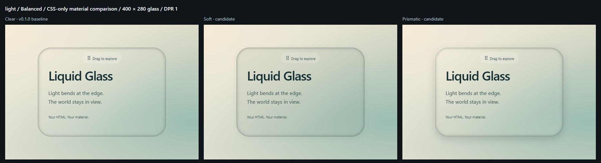
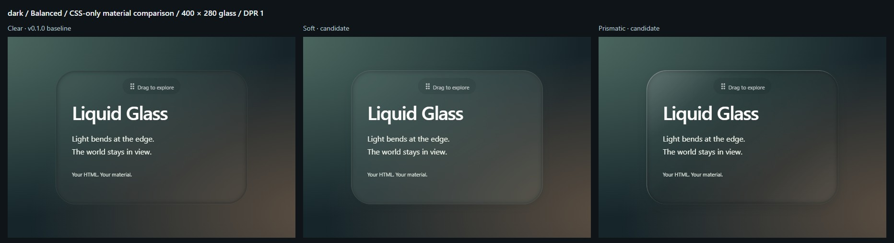
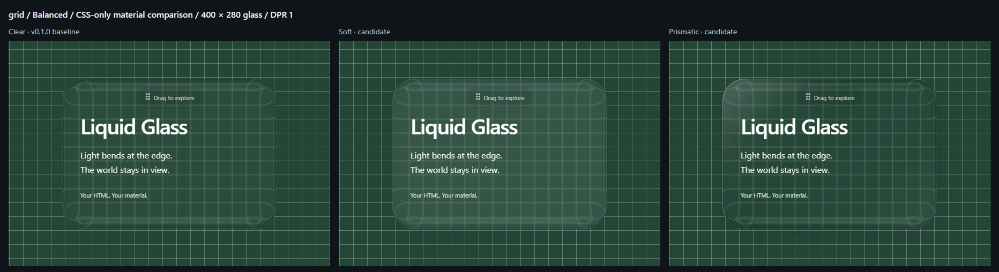
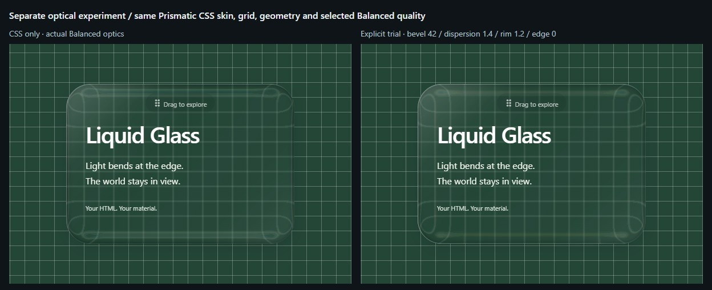
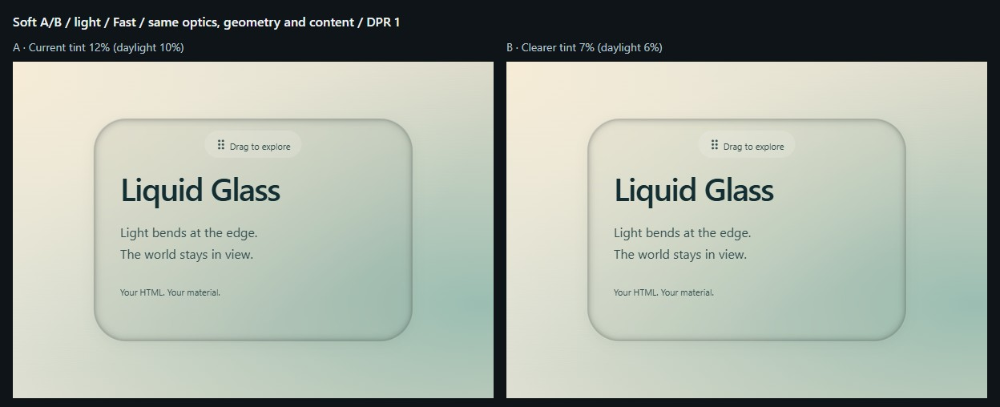
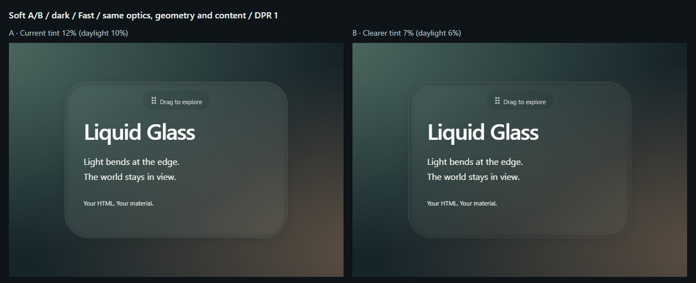
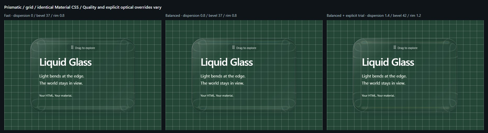
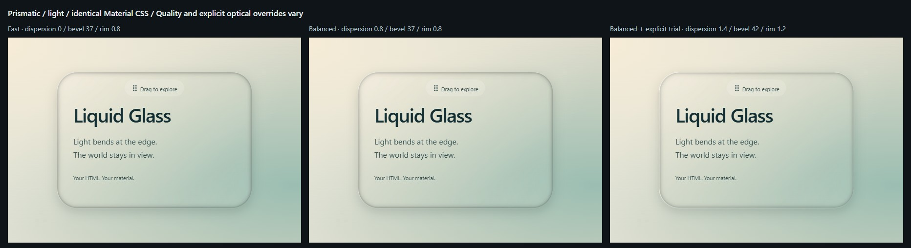

# M1 — Material exploration

Visual candidates for owner review, based on dev `ae253a5` / published v0.1.0. No new public API, package entry or release. Material is application CSS; Quality remains an independent engine choice.

| Material | Application skin | Optical parameters |
| --- | --- | --- |
| Clear | Existing v0.1.0 demo background, without additional decoration | Unchanged |
| Soft (candidate) | 12% environmental tint on dark scenes / 10% on daylight, shallow shadow and a very soft inner light | Unchanged |
| Prismatic (candidate) | Neutral, localized gloss and shallow depth; no fixed neon colors | Unchanged |

Skins are scoped to the public Playground. Decorative pseudo-elements have `pointer-events:none`; the existing engine owns `backdrop-filter`. No wallpaper brightness sampling, new image assets, render engine or library components are introduced. The Hook DIY page and historical fixture keep their existing presentation.

## Local review / 本地审查

```sh
npm ci
npm run dev -- --port 5173
```

Open these URLs and use the Material buttons without changing Quality:

- [Clear / daylight](http://127.0.0.1:5173/?lang=en&quality=Balanced&material=clear&background=light)
- [Soft / daylight](http://127.0.0.1:5173/?lang=en&quality=Balanced&material=soft&background=light)
- [Prismatic / daylight](http://127.0.0.1:5173/?lang=en&quality=Balanced&material=prismatic&background=light)
- [中文 / 深色对照](http://127.0.0.1:5173/?lang=zh-CN&quality=Balanced&material=soft&background=dark)
- [Prismatic / precision grid](http://127.0.0.1:5173/?lang=en&quality=Balanced&material=prismatic&background=grid)

Change Background to daylight, night, grid, forest or a local upload. Choose Native controls to try text selection, focus, clicking and disabled buttons. Advanced optics contains the CSS fallback preview. Reset restores Clear + Balanced, the original forest and geometry defaults. Material, named Quality, language and built-in background are shareable; custom optical edits and uploaded blobs are local to the current page.

中文：先保持 Balanced，依次切换 Clear（清透）、Soft（柔光）、Prismatic（棱彩），再更换柔和日光、深夜色调或精确网格。光学几何保留斜面／厚度／磨砂调节。原生控件模式可检查输入、选择、按钮禁用及拖动。材质只改视觉皮肤，不修改当前光学参数。

## Matched CSS-only comparison

Actual Chrome 156.0.8078.80 rendering on Windows. Every column uses the same 1440 × 1000 viewport, DPR 1, 1010 × 618 scene, centered 400 × 280 glass, 42px radius, English content, installed Aptos/Segoe UI fonts, position and Balanced optics with no overrides. Each image crops the same 600 × 420 scene region. No rotation or post-processing changes the material. Contact sheets are JPEG quality 90; lossless individual captures and metadata are generated under ignored `performance-results/m1/`.







The differences are deliberately restrained. Soft adds tint rather than a white fog; Prismatic emphasizes local surface gloss. Color separation still depends on the backdrop and the selected optics; the CSS skin alone does not increase dispersion. Smooth gradients reveal less refraction than the grid. These are candidates, not approved final presets.

## Separate optical experiment

Advanced optics → **Try recommended optics (experiment)** explicitly overlays bevel 42, dispersion 1.4, rim 1.2 and edge 0. It never changes the selected Quality or saved `scene.opts`; switching it off restores the previous options, including custom values. Material changes do not toggle this experiment. Editing optics or choosing Quality ends it. A status message and the inspector show the effective overrides. It is off on first load/Reset and is never enabled by a shared URL.

中文：强化光学必须在“高级光学”中显式开启，不能用右侧效果替代上面的纯 CSS 材质比较。关闭即恢复之前的配置；在试用时所选画质名称不变，但实际光学参数已被临时覆盖，包括 Fast 的色散，因此界面会明确提示。



## Verification and reproduction

```sh
npm run check
# With the local dev server running:
node scripts/capture-materials.mjs
```

The optional `--compare-baseline` capture flag requires clean v0.1.0 scene captures under `performance-results/m1-baseline/{grid,forest}.png`, produced at the identical viewport/DPR/fonts. It does not regenerate or alter historical golden files.

- Clear's public grid and forest scenes compared with clean v0.1.0 source `b157017`: **0 changed pixels** at the matched viewport.
- Material changes preserve the same `scene.opts` object, selected Quality, DOM elements, filter nodes and SVG contents at Balanced/Fast/Reference; **0 new maps / 0 PNG encodes**.
- Five new browser checks cover independent skins, URL/default/Reset, reversible optical trial, bilingual mobile native controls/drag/upload/fallback and fixture isolation.
- Existing layout checks exercise both pages/languages at 390/768/1440/1920px, including all expanded property groups.
- The full check includes Node contracts, TypeScript/builds, historical exact Windows pixels, portable map/SVG contracts, independent tarball types/SSR/StrictMode/production and both static URL bases.

Result on 2026-11-06: **`npm run check` passed** — 4 Node tests, 35 browser tests (including unchanged exact Reference and Balanced/Fast goldens), the 17-file external tarball consumer and root + `/liquid-glass/` production-path verification. Package/lock version, core/Hook/public CSS, Quality presets and all historical goldens are unchanged. The four comparison sheets total about 371 KiB.

Non-Chromium coverage uses forced fallback and browser-detection tests; physical Safari/Firefox/touch-device review remains outstanding. Arbitrary uploaded photos retain their original pixels and the demo's existing white text treatment, so their contrast still needs manual review. Public M1 screenshots use only CSS-generated backgrounds; no new forest derivatives are committed. No public Pages deployment.

**Awaiting owner visual review / 等待所有者视觉审查。** No main merge, npm version change, publication, tag, Release or M2 work is authorized by M1.

## M1-R2 — Controlled follow-up / 受控复核

Implements the [owner's R2 feedback](https://github.com/librecosta/liquid-glass/issues/10#issuecomment-6679506965). **Current remains the default; neither candidate is approved.** R1 images above are retained unchanged.

### Soft A/B — only tint opacity changes

| Variant | Forest / night tint | Daylight tint | Everything else |
| --- | --- | --- | --- |
| A · Current | `rgb(179 201 189 / 12%)` | `rgb(101 130 115 / 10%)` | R1 shadows, inner light, text and optics |
| B · Clearer | Same hue, **7%** | Same hue, **6%** | Identical to A |

Both use **Fast**, matching the quality in the owner's reviewed forest views. All R2 captures use Chrome 156.0.8078.80 on Windows, a 1440 × 1000 viewport, DPR 1, a 1010 × 618 scene, 400 × 280 glass at scene position (305,169), 42px radius, identical English text/fonts and a 600 × 420 crop. Contact sheets use JPEG quality 90; lossless originals and actual effective optics are recorded in `performance-results/m1-r2/`.





The forest pair is local-only: `performance-results/m1-r2/soft-forest.jpg`. It is not committed because original photo rights remain unverified. 中文观察：森林中 B 的浅灰覆盖感稍弱，背景明暗更直接；日光与深夜中的差别更细微。B 也减少了 Soft 的环境着色感。文字颜色、阴影和折射保持一致；截图未见明显可读性损失。**不预先判断 B 胜出，等待所有者选择。**

### Prismatic — same skin, different optics

| Column | Selected Quality | Bevel | Dispersion | Rim | Edge | Displacement channels |
| --- | --- | --- | --- | --- | --- | --- |
| 1 | Fast | 37 | 0 | 0.8 | 0 | 1 |
| 2 | Balanced | 37 | 0.8 | 0.8 | 0 | 3 |
| 3 | Balanced + **explicit optical trial** | 42 | 1.4 | 1.2 | 0 | 3 |





Prismatic CSS is unchanged in every column. Columns 1→2 change Quality; 2→3 explicitly overlay the existing recommended optics. Material switching itself applies neither change. 中文观察：网格中，右列的边缘弯曲范围和光带变化更容易观察；Fast→Balanced 的色散差异较细。柔和日光的色散差异更弱，主要能看出光泽与厚度感变化。不能将这些差异归因于 Material CSS，也不据此冻结 Prismatic 风格。

### Reproduce and verify

- With the dev server running: `node scripts/capture-materials.mjs --r2`. This writes four new CSS-background sheets under `docs/m1/r2/` and the forest pair only under the ignored local directory. It never overwrites R1 images.
- Open [Current A](http://127.0.0.1:5173/?lang=zh-CN&material=soft&quality=Fast&background=light&softVariant=current) / [Clearer B](http://127.0.0.1:5173/?lang=zh-CN&material=soft&quality=Fast&background=light&softVariant=clearer). The bilingual A/B buttons appear only with Soft. Missing/invalid variant and Reset restore Current. Quality, custom optics and uploaded images stay independent.
- For Prismatic, choose Fast, then Balanced, then explicitly enable **Try recommended optics** in Advanced optics. Closing the trial restores saved optics; the trial is never activated by a shared URL.
- R2 browser checks verify exact alpha values, unchanged shadows/inner light/text/filter, retained DOM and `scene.opts`, zero new maps/PNG encodes during A/B, normal and forced-fallback rendering, bilingual mobile native inputs/buttons, URL persistence, Reset and fixture isolation. Clear's matched public grid/forest screenshots still have **0 changed pixels** against v0.1.0.

R2 validation on 2026-11-06: **`npm run check` passed** — 4 Node contracts, 38 browser tests, unchanged exact Reference/Balanced/Fast goldens, TypeScript/builds, the independent 17-file tarball consumer (SSR/StrictMode/production), and both production URL bases. Core, public API/CSS, Quality presets, package/lock version, R1 screenshots and historical goldens are unchanged.

Awaiting owner selection of Soft A/B and Prismatic direction. No main merge, publication, #10 closure or M2 work.
